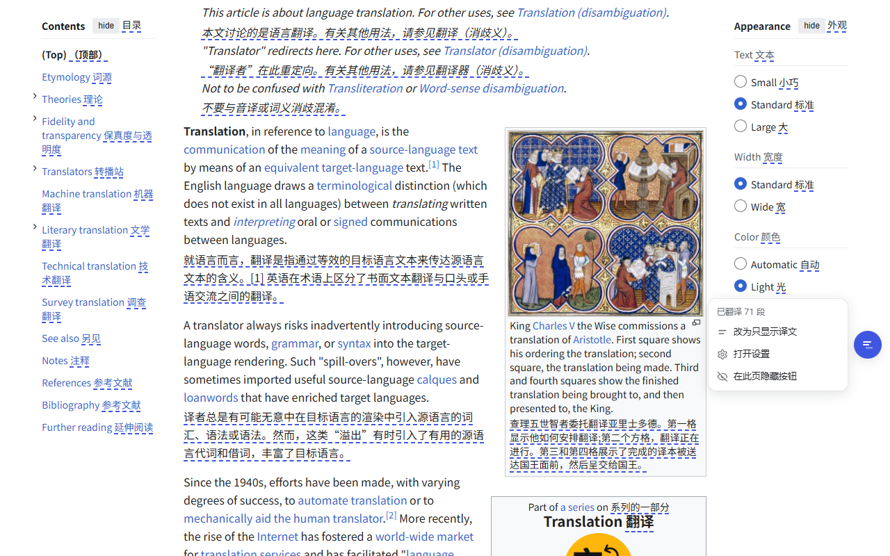
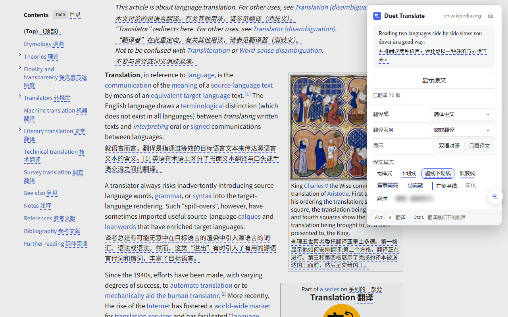
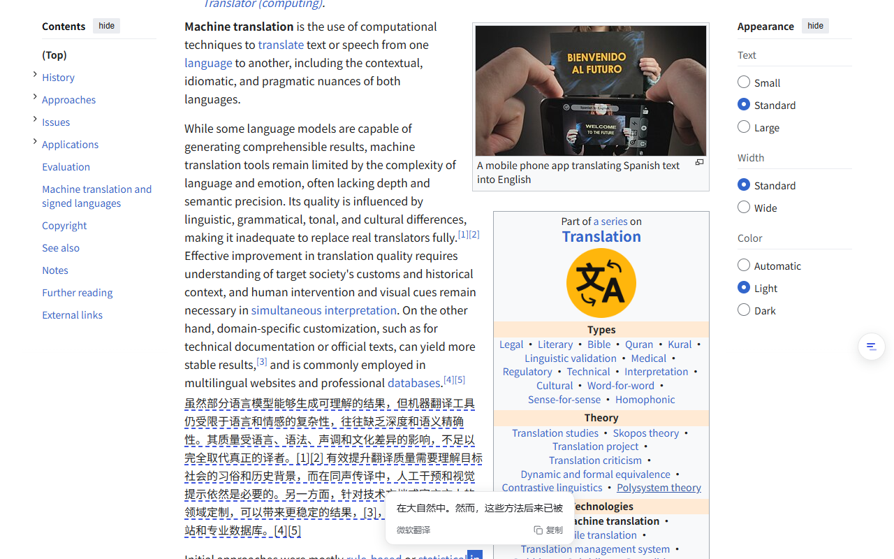
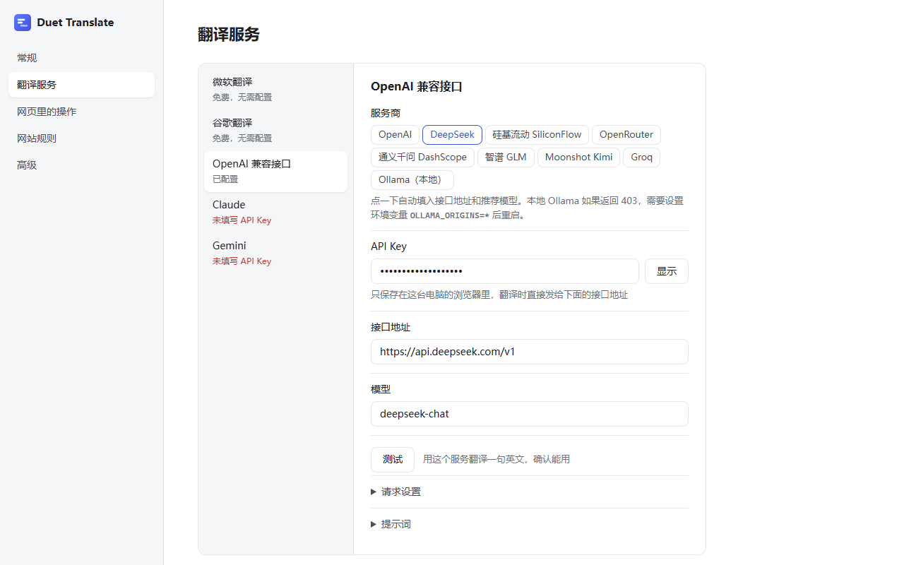

<div align="center">


# Duet Translate

**开源的双语对照网页翻译扩展，可以接入你自己的 AI API**

[](LICENSE)


</div>

译文显示在每段原文下方，滚动到哪翻译到哪。可以使用免费的微软、谷歌翻译，也可以接入 OpenAI、DeepSeek、Claude、Gemini、Ollama 等服务。代码零依赖、无需构建，下载后就能加载使用。



| 只看译文 | 工具栏弹窗：进度、样式预览、本站规则 |
| --- | --- |
|  |  |
| **悬停翻译 + 划词翻译** | **设置：服务列表、预设、一键测试** |
|  |  |

## 功能

- **双语对照**：自动识别段落，译文插在原文下方，沿用网页原来的字体和排版
- **按需翻译**：只翻译屏幕附近的内容；无限滚动、单页应用里后加载的内容也会自动翻译
- **仅译文模式**：一键隐藏原文
- **悬停翻译**：鼠标停在段落上按一下 `Ctrl`，只翻译这一段
- **划词翻译**：选中文字后会弹出翻译气泡，右键菜单里也能翻译
- **输入框翻译**：输入完后快速连按三次空格，内容会被替换成英文
- **10 种译文样式**：下划线、高亮、马克笔、模糊等，可以自定义主题色和 CSS
- **网站规则**：可设置总是翻译或从不翻译某个网站，也可以自动翻译外语页面
- **省请求**：多个段落合成一次请求、限制并发、本地缓存，同样的内容不会重复翻译

## 翻译服务

| 服务 | 说明 |
| --- | --- |
| 微软翻译（默认） | 免费，不用配置，国内可以直接用 |
| 谷歌翻译 | 免费，需要能访问 Google |
| OpenAI 兼容接口 | 内置 OpenAI、DeepSeek、硅基流动、OpenRouter、通义千问、智谱、Kimi、Groq、Ollama 预设 |
| Claude / Gemini | 官方 API |

模型、Temperature、System Prompt、并发数和每批大小都可以自定义。API Key 只保存在本机浏览器，请求直接发到你填的接口地址。

## 安装

**Edge 扩展商店**：审核中，上架后会在这里放链接。

**安装包（Chrome / Edge）**：适合进不了扩展商店，或者想直接下载安装的用户。

1. 在 [Releases](https://github.com/VOfficial404/duet-translate/releases/latest) 页面下载 `duet-translate-x.y.z-chromium.zip`，并解压到一个**固定位置**的文件夹
2. 打开 `chrome://extensions` 或 `edge://extensions`，开启 **开发者模式**
3. 点 **加载已解压的扩展程序**，选择刚才解压出来的文件夹

浏览器每次启动都会从这个文件夹加载扩展，所以装好后不要删除或移动它。更新时用新版本的文件覆盖进去，然后在扩展页点 **重新加载**。Chrome 和 Edge 不允许从商店以外的地方直接安装 `.crx` 文件，所以只能这样加载。

**Firefox 121+**：在 Releases 页面下载 `duet-translate-x.y.z-firefox.zip`，打开 `about:debugging#/runtime/this-firefox`，点 **临时载入附加组件** 并选择这个 zip，然后在扩展的权限设置里允许它访问所有网站。临时载入的扩展在 Firefox 重启后会被移除。

## 使用

| 操作 | 快捷方式 |
| --- | --- |
| 翻译整页 / 显示原文 | `Alt+A`，或点页面右侧的悬浮球 |
| 切换 双语 / 仅译文 | `Alt+S` |
| 翻译单个段落 | 鼠标停在段落上，按一下 `Ctrl` |
| 输入框翻译 | 快速连按三次空格 |

**接入 AI**：打开设置 → 翻译服务 → OpenAI 兼容接口，点一个服务商（自动填好接口地址和模型），填入 API Key，再点 **测试**。没配置好时，弹窗顶部会直接提示。

- 使用本地 Ollama 时 API Key 留空；如果测试返回 403，设置环境变量 `OLLAMA_ORIGINS=*` 后重启 Ollama。
- 使用推理模型（o 系列、GPT-5、DeepSeek-R1）时 Temperature 留空。这类模型比较慢，网页翻译更推荐非推理的小模型。

## 开发

```
src/background.js   翻译服务、批量解析、并发、重试、缓存
src/content.js      段落识别、懒加载、译文渲染、悬停/划词/输入框翻译、悬浮球
src/options.*       设置页      src/popup.*   工具栏弹窗
scripts/pack.ts     打包 zip（bun scripts/pack.ts → dist/）
```

**发布新版本**：修改 `manifest.json` 里的 `version`，提交后推送对应的标签（如 `git tag v0.2.0 && git push origin v0.2.0`）。GitHub Actions 会自动打包，并把 Chrome/Edge 和 Firefox 两个安装包发布到 Releases。

还没做的功能：PDF / EPUB、视频字幕、移动端。欢迎提 PR。

> 本项目与沉浸式翻译（Immersive Translate）没有任何关联。[隐私政策](PRIVACY.md) · [GPL-3.0](LICENSE)
